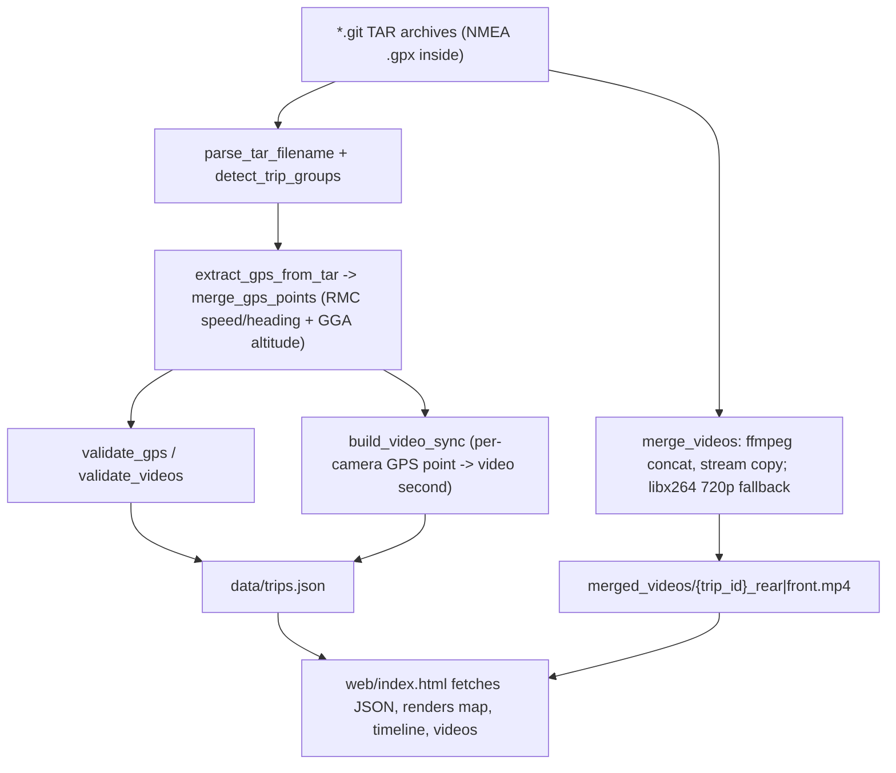

# CLAUDE.md

This file provides guidance to Claude Code (claude.ai/code) when working with code in this repository.

# DDpai Z50 Pro Dashcam Extractor

Extracts GPS and trips from DDpai Z50 Pro dashcam archives into a JSON database (`data/trips.json`), merges the rear/front videos, and serves a static web UI ("Estúdio de viagem", Portuguese UI) that loads that JSON dynamically. Python standard library only; the frontend is plain HTML/JS (Leaflet from cdnjs, no Chart.js, no build step). The repo is **public**: never commit personal data (trip JSON, videos, photos, coordinates, places).

## Quick Start

```bash
./build.sh                  # TAR + videos -> data/trips.json + merged_videos/ (args: TAR REAR FRONT OUT)
./run.sh [port]             # static server with Range support, http://127.0.0.1:8765/web/ (default port 8765)
python3 -m unittest discover -s tests -v   # test suite

python3 -m src.processing.trip_import      # import trips of one day from a mounted DDPAI disk
./watch.sh [--parallel]                    # macOS-only SD card watcher (see Input paths)
```

`./run.sh` refuses to start without `data/trips.json`. The server binds to `127.0.0.1` only. Deep link to a trip: `/web/#viagem-<id>`.

## ⚠️ MUST DO: Development Workflow (Git Flow + TDD)

**🔴 ALL changes to this project MUST follow this exact workflow — NO EXCEPTIONS:**

1. **Branch:** Create a feature branch from `develop` (format: `feature/*`, `fix/*`, `docs/*` or `refactor/*`)
   - ✅ DO: `git checkout -b feature/video-sync-gps`
   - ❌ DON'T: Commit directly to main or develop

2. **Test:** Write tests FIRST (Test-Driven Development)
   - ✅ DO: Add test cases under `tests/` before implementation
   - ✅ DO: Run tests locally: `python3 -m unittest discover -s tests -v`
   - ❌ DON'T: Write code without tests

3. **Code:** Implement changes, confirm all tests pass
   - ✅ DO: Follow commit message conventions (see CONTRIBUTING.md)
   - ✅ DO: Keep changes focused (one feature per PR)
   - ❌ DON'T: Mix multiple features in one commit

4. **PR:** Push branch and create Pull Request on GitHub
   - ✅ DO: Push with: `git push -u origin feature/your-name`
   - ✅ DO: Link PR to GitHub Projects board
   - ❌ DON'T: Merge directly without PR review

5. **Review:** Get approval from project owner before merging
   - ✅ DO: Wait for code review feedback
   - ✅ DO: Fix review comments in new commits (don't amend)
   - ✅ DO: Use `/verify-before-completion` skill to confirm work is ready
   - ❌ DON'T: Self-approve or force-merge

6. **Merge:** Merge via GitHub UI (squash or rebase to keep history clean)
   - ✅ DO: Merge through GitHub interface
   - ✅ DO: Delete feature branch after merge
   - ❌ DON'T: Use force-push (`git push --force`)
   - ❌ DON'T: Merge to main directly (use develop first)

7. **Sync:** After merge to main, sync develop branch
   ```bash
   git checkout develop
   git pull origin develop
   git merge main
   git push origin develop
   git checkout main
   ```

**Why This Matters:**
- ✅ Code quality & test coverage before production
- ✅ Clean git history (easy to revert if needed)
- ✅ Prevents conflicts between main/develop
- ✅ Every commit is deployable
- ✅ Easy code review & knowledge sharing

**For Claude Code Users:**
- 🔴 **MUST** use `/verify-before-completion` skill before marking work done
- 🔴 **MUST** follow TDD: tests first, then code
- 🔴 **MUST** create feature branches (never commit to main/develop directly)
- 🔴 **MUST** use Conventional Commits for clear history

## Documentation Standards

**Diagrams & Visualizations:**
- 🔴 **MUST** use Mermaid for all diagrams (flowcharts, architecture, data flow, etc.)
- Save Mermaid code in design specs and commit to `docs/superpowers/specs/`
- Renders automatically on GitHub (no external tools needed)


## Architecture & Workflow



Trip id = UTC start of the first archive, `YYYYMMDDHHMMSS`. Input archives are named `YYYYMMDDHHMMSS_DURATION_SECONDS.git`.

### Code map

- `src/extraction/build_database.py` (main, run via `./build.sh`): NMEA parsing (`parse_rmc`, `parse_gga`, `extract_gps_from_nmea`), `detect_trip_groups` (splits on `GAP_THRESHOLD`, pre-filters parking files with `is_parking_file`), `detect_idle_segments`, `compute_trip_stats`, `merge_videos`, `main()` writes `data/trips.json` and `data/merge_report.txt`.
- `src/extraction/build_database_parallel.py`: same pipeline, groups merged in a thread pool (up to 4 groups x 2 cameras); **imports from `build_database`**, so shared logic and constants live only there. Run via `./tools/build_parallel.sh` (same positional args as `build.sh`).
- `src/extraction/video_timeline.py`: `build_video_sync`, estimates the GPS (UTC) vs camera-clock offset (median per-segment offset) and maps each GPS point to a second in each merged video, with a `confidence` (`high`/`medium`/`low`).
- `src/processing/trip_import.py`: interactive import from a mounted disk (auto-detects `/run/media/*/*`, `/media/*/*`, `/Volumes/*` having `DCIM/203gps/tar`); options `--disco PATH`, `--data AAAA-MM-DD` (default: yesterday, local time), `--todas`, `--substituir-indice-ilegivel`. Runs `build.sh` on a temporary copy and merges the result into `data/trips.json` (same-id trips replaced, others kept), backing up the old index to `working_data/backups/`.
- `src/processing/http_server.py`: Range-capable static server used by `run.sh` (needed to seek in large videos).
- `tools/refresh_video_sync.py --disco <mount> [--dry-run]`: recomputes points and `video_sync` for already-imported trips without re-merging video (backs up the index first).
- `tools/extract_photos.sh`, `tools/cdp-shot.js` (headless-Chrome screenshot, Node 22+), `tools/debug_videos.sh`, `tools/install_fftools.sh`.
- `src/processing/merge_trips.py`, `src/video/merge_videos.py`, `src/extraction/ddpai_route_improved.py`: legacy/standalone, rarely used; `merge_trips.py` and `tools/debug_videos.sh` still contain hardcoded macOS paths.
- `web/index.html` (UI, CSS and app logic), `web/trip-model.js` (pure trip/point model, also loaded by Node tests), `web/video-sync.js` (point <-> video-time mapping, linked-player helpers, confidence warning).

### Input paths

- `./build.sh` / `tools/build_parallel.sh` default to `working_data/tar`, `working_data/videos/rear`, `working_data/videos/front` and output dir `.` (all gitignored; override with positional args). `LOCAL_SETUP.md` describes the author's local layout.
- `src/extraction/build_database.py` has its own `DEFAULT_*` constants (lines 23-26) that are **hardcoded macOS paths of the original author**; they only apply if the module is run directly without arguments. Always go through `build.sh` or pass all four arguments.
- `watch.sh` hardcodes `/Volumes/ddpai/DCIM/...` and uses `osascript` notifications: macOS only. On Linux use `trip_import`.

## Data Processing Details

- **Trip detection:** `GAP_THRESHOLD = 30*60` s between archives splits trips. Parking filter (`is_parking_file`): an archive is parked if distance < 0.6 km OR average speed < 3.0 km/h (unreadable archives are also classified as parked but reported as warnings by `trip_import`).
- **GPS:** `$GPRMC` (speed, heading) + `$GPGGA` (altitude); knots x 1.852 = km/h; DDMM.MMMMM -> decimal degrees; timestamps UTC. Bad checksums/malformed sentences are skipped. Stale buffer residue (a fix whose date+time goes backwards or jumps forward > `MAX_FIX_FORWARD_JUMP_S` = 120 s) ends extraction for that file.
- **Idle segments:** `IDLE_SPEED_THRESHOLD = 0.5` km/h for at least `IDLE_DURATION_THRESHOLD = 300` s; stored per trip as `idle_segments` (start_index, end_index, duration_s, distance_km).
- **Video merging (`merge_videos`):** ffmpeg concat. **Default is stream copy** (`use_stream_copy=True`, `-c:v copy -c:a copy`: lossless, original resolution/codec, I/O bound). Timeout is dynamic (`max(300, MB/10 + 120)` s), retried up to 2 times on timeout with +50% each. If stream copy fails (non-timeout error), it **falls back to libx264 re-encoding**: `scale=-2:OUTPUT_HEIGHT` (720), `VIDEO_CRF` 26, `VIDEO_PRESET` 'fast', AAC 128k, fixed 1800 s timeout. Constants live near the top of `build_database.py` (the parallel build uses them via import). Outputs `merged_videos/{trip_id}_rear.mp4` / `_front.mp4`.
- **Trip JSON fields** (per entry in `trips[]`; top level also has `generated_at`): `id, label, date, duration_min, distance_km, max_speed, avg_speed, points, video_rear, video_front, video_status, video_notes, idle_segments, video_duration_s, start_timestamp, gps_points_count, video_duration_status, video_sync, sparse_timestamps`. Changing this schema requires matching changes in `web/`. Older JSON without `video_sync` falls back to linear interpolation in the frontend.
- **`data/trips.json`, `data/merge_report.txt`, `merged_videos/`, `working_data/`, `extracted_photos/` are generated/local and gitignored.** Inspect with `python3 -c "import json; d=json.load(open('data/trips.json')); print(len(d['trips']), 'trips', d['generated_at'])"`. Do not copy trip data, coordinates or places into tracked files.

## Dashboard (web/index.html)

Trip detail screen ("Estúdio de viagem", redesign option C "Diário de viagens"; design in `docs/superpowers/specs/2026-11-22-trip-detail-redesign-design.md`):

- Opens the trip of `#viagem-<id>` (or the latest); the hash is kept in sync (`replaceState`).
- Layout: video stage + Leaflet map + chapters list; chapters include stops, max speed, climbs/descents and "Sem vídeo" gaps. Speed/altitude are shown in an SVG metro-line timeline where the route segment is selectable (drag handles; export the selection as GPX/KML, geometry only).
- One transport with real clock time controls everything. Lock button "Câmeras juntas" (default: both cameras follow play/pause/seek) / "Câmeras separadas". One main camera with the other as picture-in-picture (or side by side); swap with `C`.
- Cameras without footage for a GPS point show a "Sem gravação" note; GPS is the source of truth and the map stays interactive. `video_sync.confidence` of `medium`/`low` shows a warning.
- Map tiles: OpenStreetMap, filtered by the per-theme CSS token `--tile-filter` (light/dark follows `prefers-color-scheme`).
- Keyboard shortcuts (ignored in text fields): Space/K play-pause, J/L or arrows +-10 s (Shift: 60 s), I/O mark start/end of selection, M expand map, C swap main camera, Esc close popovers.
- Needs HTTP (not `file://`) to fetch the JSON; Leaflet loads from cdnjs and tiles from OSM, so the map needs internet.
- Customizing: edit the CSS tokens at the top of `web/index.html` and its JS in place; keep pure logic in `web/trip-model.js` / `web/video-sync.js` so Node tests can cover it.

## Testing

- Run all: `python3 -m unittest discover -s tests -v`. Frontend logic tests run `web/trip-model.js` / `web/video-sync.js` through `node -e` (skipped when Node is missing); `tools/cdp-shot.js` needs Node 22+ and `google-chrome`.
- Mock FFmpeg in unit tests; manual browser checklist in `tests/test_video_sync_frontend_manual.md`. For UI-impacting work, run `./run.sh` and check map, timeline and video controls in a browser.
- CI (`.github/workflows/ci.yml`, PRs/pushes to `main`/`develop`) only runs `py_compile`, shellcheck (non-blocking), README/LICENSE/CHANGELOG presence and a JSON validity check; it does **not** run the unit tests, so run them locally before opening a PR.

## Dependencies

Python 3.6+ (standard library only), FFmpeg/ffprobe with libx264 (`ffmpeg -codecs | grep h264`), a modern browser. Node 22+ optional (frontend tests, screenshots). Merged videos need several GB of disk per day of footage.

## Gotchas

- `build_database.py` and `build_database_parallel.py` must both keep working; the parallel one imports from the sequential one.
- **HEVC:** stream copy preserves the camera's codec, and HEVC playback depends on the browser/OS. If a video does not play, check it with `ffprobe` and consider re-encoding (`use_stream_copy=False`).
- **GPS vs camera clock:** the offset is an estimate (about 1 s resolution from file names); `confidence` reflects clock calibration only, not footage coverage (`status`: `ok`/`partial`).
- **Stale GPS residue** can make a few `.git` files count as parked; `refresh_video_sync.py` keeps the already-imported trip composition, a fresh import would drop them. Point indices change when residue is removed, so previously selected ranges no longer apply.
- Some TAR archives may be corrupted/truncated: extraction keeps what it can read and `trip_import` warns with the file list.
- Video paths in the JSON are relative (`merged_videos/*.mp4`) and resolved from the server root; run the server from the repo root (`./run.sh` does).
- `watch.sh` polls every 30 s, backs up `data/trips.json` to `data/trips.json.bak` before each rebuild and keeps its state in `data/.last_tar_count`.

## Project Layout

```
build.sh  run.sh  watch.sh        # entry points
AGENTS.md  LOCAL_SETUP.md  README.md  LICENSE
src/extraction/    build_database.py, build_database_parallel.py, video_timeline.py, ddpai_route_improved.py (reference)
src/processing/    trip_import.py, http_server.py, merge_trips.py (legacy)
src/video/         merge_videos.py (legacy wrapper)
tools/             build_parallel.sh, refresh_video_sync.py, extract_photos.sh, cdp-shot.js, debug_videos.sh, install_fftools.sh
tests/             unittest suite (test_*.py), trip_model_cases.js, manual frontend checklist
web/               index.html, trip-model.js, video-sync.js, favicon.*
docs/              CONTRIBUTING.md, CHANGELOG.md, VIDEO_DEBUG_GUIDE.md,
                   superpowers/{specs,plans}/ (design specs and plans), ux/redesign-2026-11/ (redesign prototypes, PROPOSTA.md)
data/ merged_videos/ working_data/ extracted_photos/   # generated or local, gitignored
```

`AGENTS.md` holds the shorter contributor guidelines (style, commit conventions); keep it consistent with this file.
