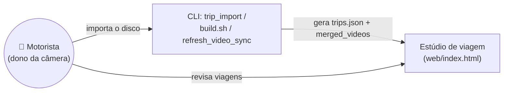
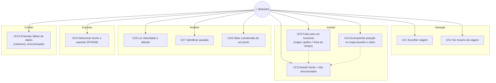
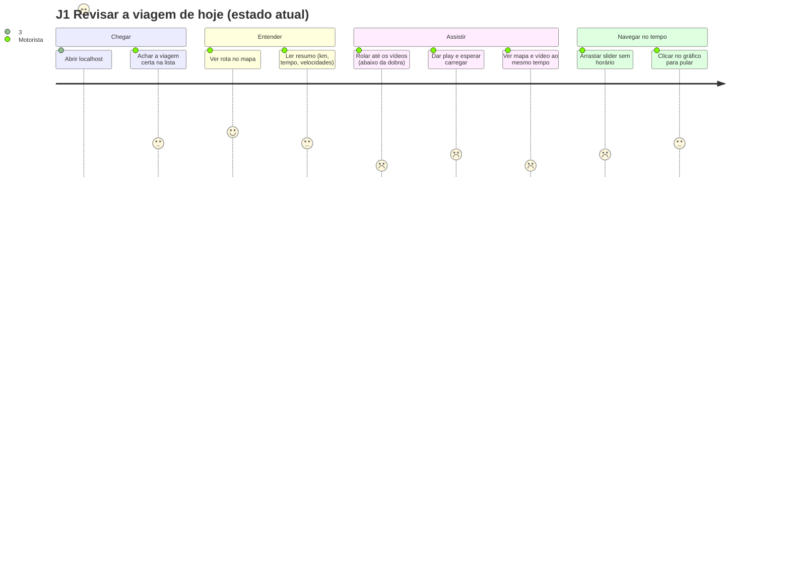
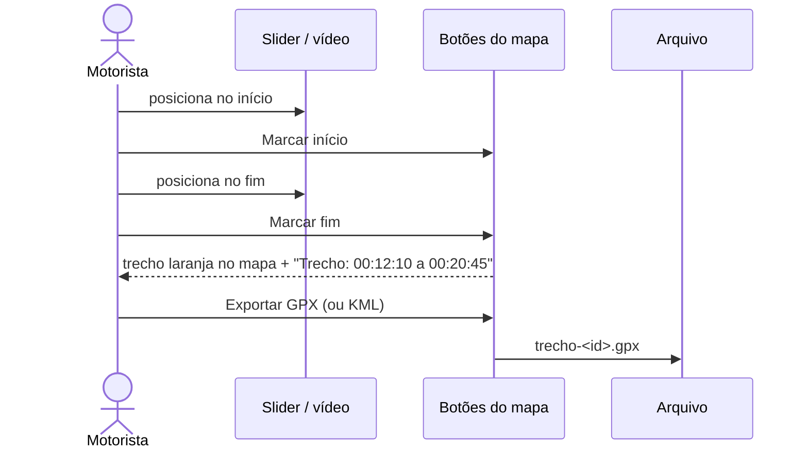

# Estúdio de viagem — Casos de uso e jornada funcional

**Data:** 2026-11-22
**Status:** Levantamento (base para o redesign de UX)
**Escopo:** `web/index.html` + `web/video-sync.js` na v0.5.0. Este documento descreve o que a página faz
hoje e para quem. Não descreve implementação nova.

---

## 1. Contexto e propósito

O usuário é dono de uma dashcam DDPAI Z50 Pro, com câmera dianteira e traseira. Depois de rodar, importa o
disco da câmera pela linha de comando (`trip_import`), que gera `data/trips.json` e os vídeos unidos em
`merged_videos/`. Em seguida, abre o "Estúdio de viagem" no navegador (`./run.sh` →
`http://localhost:8765/web/`).

A página tem um propósito: **revisar uma viagem cruzando três fontes no mesmo instante: onde eu estava
(mapa), como eu estava dirigindo (velocidade/altitude) e o que as câmeras viram (frente e trás).**

| Item | Situação atual |
|------|----------------|
| Usuário | 1 pessoa (dono da câmera), uso pessoal, local (localhost), em português |
| Dispositivo principal | Desktop/notebook, 1280–1920 px de largura |
| Dispositivo secundário | Tablet ou celular na rede local (há layout responsivo, mas é pouco usado) |
| Volume | Hoje 3 viagens (21/11); cresce a cada importação (dezenas a centenas) |
| Tamanho típico | 1–3 h por viagem, 60–120 km, ~5–9 mil pontos GPS (1/s), vídeos de 5–23 GB por câmera |

## 2. Atores

Só existe um ator humano. A importação é feita fora da página, e a página só lê o que a CLI gerou.

## 3. Casos de uso (o que a página faz hoje)

| ID | Caso de uso | Como funciona hoje | Elementos atuais |
|----|-------------|--------------------|------------------|
| UC1 | Escolher viagem | Lista lateral com rótulo "21/11 09:03 → 21/11 11:54", km e min. A primeira viagem abre automaticamente | `#trips-list`, `renderTripList` |
| UC2 | Ver resumo | Card "Detalhes da viagem" em formato de tabela: data, distância, duração, velocidade máx/média, nº de pontos GPS, lista de paradas | `#trip-details` |
| UC3 | Assistir frente + trás | Dois `<video>` nativos lado a lado, abaixo da dobra. Modo "Sincronizado" (padrão): play, pause e seek em um propagam para o outro, usando o mapeamento por câmera (`video_sync`). Modo "Independente": cada câmera funciona sozinha. Carregamento sob demanda (lazy) no primeiro play | `#video-rear`, `#video-front`, `video-sync.js`, `#sync-mode-toggle` |
| UC4 | Acompanhar posição | Durante a reprodução, o marcador azul anda no mapa, o playhead laranja anda nos gráficos e o slider acompanha. "Seguir veículo" centraliza o mapa no marcador. Overlay "▶ Vídeo: m:ss / m:ss" no mapa | `updateMapMarker`, `#map-follow`, `#video-time-indicator` |
| UC5 | Pular para um momento | Clicar no mapa leva ao ponto GPS mais próximo; clicar no gráfico, ao índice; arrastar o slider `#trip-timeline` também funciona. Em todos os casos os vídeos fazem seek | `seekToPoint` |
| UC6 | Ler telemetria | Dois gráficos Chart.js (velocidade, altitude) com eixo X oculto (índice de ponto, não tempo) e playhead | `#chart-speed`, `#chart-altitude` |
| UC7 | Identificar paradas | Trechos parados (≤0,5 km/h por ≥5 min) aparecem tracejados em cinza no mapa e listados em "Paradas" | `idle_segments` |
| UC8 | Obter coordenada | Clique no mapa mostra a coordenada em DMS num controle fixo, com botão "Copiar" | `#map-coordinate-control` |
| UC9 | Exportar trecho | Posicionar no tempo → "Marcar início" → posicionar → "Marcar fim" → "Exportar GPX/KML". O trecho fica laranja no mapa. Aviso de que exporta só a geometria | `#route-start/end`, `exportRoute` |
| UC10 | Entender falhas | Avisos textuais em laranja sob o mapa: sincronização parcial, confiança média/baixa do relógio, câmera sem cobertura no ponto. Faixa amarela com "Estado dos vídeos: OK / Merged 153 rear + 153 front…". Badge "Vídeo termina em" | `#sync-warning`, `#camera-coverage`, `#videoStatus`, `#video-end-badge` |
| UC11 | Tela cheia do mapa | Botão expande o card do mapa (Esc sai) | `#map-fullscreen` |

**Fora da página (CLI):** importar do disco, rebuild, refresh de sincronização, exportar fotos. São candidatos a
virar UI no futuro, mas não fazem parte deste redesign.

## 4. Jornadas funcionais

### J1 — "Revisar a viagem de hoje" (a mais frequente)

### J2 — "O que aconteceu naquele lugar ou momento?" (incidente, curiosidade)

1. O motorista lembra de um lugar ("na serra") ou de um horário ("umas 10h").
2. Abre a viagem e procura o lugar no mapa ou um pico de velocidade no gráfico.
3. Clica, e os vídeos pulam para o ponto.
4. Assiste frente e trás; volta alguns segundos; vê quadro a quadro.
5. Copia a coordenada ou exporta o trecho.

**Atritos hoje:** não há horário real (relógio) em lugar nenhum, só índice ou tempo decorrido. Não há marcos
na linha do tempo (paradas, velocidade máxima). Não existem controles de "voltar 10 s" ou "quadro a quadro"
unificados, e cada vídeo tem o próprio controle nativo. Também não há como marcar o momento e voltar a ele.

### J3 — "Extrair um trecho"

**Atritos hoje:** os 6 botões ficam sempre visíveis, mesmo quando ninguém está exportando. A seleção não aparece
na linha do tempo, só no mapa, e não dá para ajustar arrastando as pontas.

### J4 — "Posso confiar no que estou vendo?"

O motorista vê o marcador fora da estrada ou o vídeo desalinhado. Hoje os avisos são frases soltas em laranja
debaixo do mapa, e o "Estado dos vídeos" mostra informação de build em inglês ("Merged 153 rear + 153 front
videos successfully") e o caminho do arquivo `.mp4`.

## 5. Avaliação heurística do layout atual

Captura de referência: desktop 1440 px (o vídeo começa por volta de y=1300, abaixo da dobra de qualquer
notebook).

| # | Problema | Heurística (Nielsen) | Severidade |
|---|----------|----------------------|------------|
| P1 | Vídeos, o conteúdo principal, ficam abaixo da dobra; não se vê vídeo e mapa juntos sem rolar | Flexibilidade / eficiência | Crítica |
| P2 | Não há um "tempo mestre" visível: slider sem horário, gráficos sem eixo de tempo, overlay m:ss só no mapa | Visibilidade do estado | Crítica |
| P3 | Cada vídeo tem controles nativos separados; o modo de sincronização é uma barra solta com jargão | Consistência / modelo mental | Alta |
| P4 | Informação de depuração exposta: caminho do arquivo, "Merged 153…", "8752 registros", badge vermelho "172 MIN" | Estética e minimalismo | Alta |
| P5 | Toolbar com 6 botões cinza padrão do navegador e ações raras (exportar) com o mesmo peso das frequentes | Estética / hierarquia | Alta |
| P6 | Resumo da viagem em formato de planilha (rótulo à esquerda, valor à direita) | Estética / reconhecimento | Média |
| P7 | Lista de viagens sem agrupamento por dia, sem miniatura de rota, sem busca; não escala para centenas | Reconhecimento em vez de memória | Média |
| P8 | Avisos de qualidade em texto laranja solto, sem ícone, sem contexto nem ação | Ajudar a reconhecer erros | Média |
| P9 | Cabeçalho em gradiente roxo (estética ~2015) ocupa 120 px sem função | Estética e minimalismo | Média |
| P10 | Paradas e velocidade máxima não aparecem na linha do tempo, só no mapa ou na lista | Visibilidade | Média |
| P11 | Sem atalhos de teclado (espaço, ←/→, J/K/L), sem modo escuro (vídeo noturno ofusca) | Flexibilidade | Baixa |

## 6. Dados disponíveis por viagem (restrições para o redesign)

Os campos vêm de `data/trips.json` (`trips[]`). O redesign deve usar só isso, ou derivar no front:

- `label`, `date`, `start_timestamp` (UTC). O horário local da viagem pode ser calculado (hoje o rótulo já
  está em horário local).
- `distance_km`, `duration_min`, `max_speed`, `avg_speed`.
- `points[i] = [lat, lon, speed_kmh, altitude_m, heading, time_offset_s]`, com ~1 ponto/s.
- `idle_segments[] = {start_index, end_index, duration_s, distance_km}`.
- `video_front`, `video_rear` (caminhos), `video_duration_s`, `video_status`, `video_notes`.
- `video_sync = {front: [s|null], rear: [s|null], status: ok|partial|unavailable, confidence: high|medium|low, …}`.

**Derivações baratas no front:** horário real de cada ponto (`start_timestamp` + offset), marco de velocidade
máxima, faixas sem cobertura por câmera (`null` em `video_sync`), agrupamento da lista por dia, miniatura da
rota (polyline simplificada).

## 7. Restrições técnicas

- Página estática servida por `src.processing.http_server` (com Range), sem etapa de build. Bibliotecas só via
  CDN (Leaflet 1.9.4 e Chart.js 3.9.1 hoje). Tiles OSM sem chave de API (CARTO Positron/Dark Matter também
  não exigem chave).
- **Preservar** a lógica de `video-sync.js` (mapeamento por câmera, cobertura, play/pause/seek ligados).
- Vídeos enormes, carregados sob demanda. O primeiro play pode demorar. A reprodução de HEVC depende do
  navegador.
- Interface em pt-BR; manter a acessibilidade já testada (`tests/test_frontend_accessibility.py`): `lang`,
  foco visível, lista operável por teclado, `aria-pressed`, nomes acessíveis em vídeos e gráficos,
  `role="status"` nas mensagens, ausência de `alert()`. Um redesign pode trocar os IDs, desde que atualize os
  testes junto, no mesmo PR (TDD).

## 8. O que "melhor" significa (critérios de sucesso do redesign)

1. **Em uma tela de 1440×900, sem rolar:** vídeo dianteiro, vídeo traseiro (ou alternância), mapa com
   posição, telemetria e linha do tempo.
2. **Um único controle de tempo** (play/pause, ±10 s, velocidade de reprodução) que comanda as duas câmeras, o
   mapa e os gráficos, com horário real visível.
3. **Linha do tempo com marcos:** paradas, velocidade máxima, trechos sem vídeo, seleção de trecho.
4. **Nada de depuração por padrão:** caminhos, contagem de pontos e notas de build ficam em "detalhes
   técnicos".
5. **Avisos contextuais e humanos:** um indicador de qualidade de sincronização com explicação ao passar o
   mouse.
6. **Visual contemporâneo:** tipografia e espaçamento consistentes, modo escuro (vídeos noturnos),
   controles próprios em vez de botões padrão.
7. **Escala:** a lista de viagens agrupada por dia, com resumo e miniatura.
