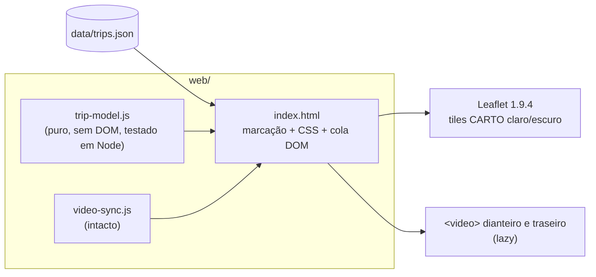

# Redesign da tela de viagem (opção C, fase 1) — Design

**Data:** 2026-11-22
**Status:** Rascunho para aprovação
**Base:** [casos de uso e jornada](2026-11-22-dashboard-use-cases-journey.md) · [proposta UX](../../ux/redesign-2026-11/PROPOSTA.md) ·
protótipo de referência visual `docs/ux/redesign-2026-11/opcao-c.html#detalhe` (+ `proto-core.js`)

---

## 1. Intenção

O dono do projeto acha a página atual com cara de "html anos 90" e escolheu a **opção C ("Diário de viagens")**.
Esta fase troca o `web/index.html` pela **tela de detalhe da viagem** da C. O objetivo é ver vídeo, mapa,
telemetria e linha do tempo juntos, com um único controle de tempo, horário real e a viagem contada em
capítulos. A biblioteca (calendário, "continuar de onde parou") fica para a fase 2.

## 2. Objetivos, não-objetivos e anti-objetivos

**Objetivos (fase 1)**
1. Em 1440×900, sem rolar: vídeo dianteiro com traseiro em miniatura, mapa com posição, capítulos, controle
   de tempo e linha do tempo com velocidade e altitude.
2. Um único controle (reproduzir/pausar, −10 s/+10 s, 1×/2×/4×) comanda as duas câmeras, o mapa e a linha do
   tempo, mostrando **horário real** e tempo decorrido.
3. Capítulos automáticos (Partida, Subida/Descida, Parada, Velocidade máxima, Sem vídeo, Chegada) na lista e
   como estações da linha do tempo; clicar leva ao momento.
4. Todas as funções de hoje continuam disponíveis: UC1–UC11 (ver a especificação de casos de uso), inclusive
   seleção e exportação GPX/KML, copiar coordenada, seguir veículo, mapa ampliado, modo
   sincronizado/independente.
5. Tema claro e escuro, atalhos de teclado e layout de celular sem rolagem horizontal.

**Não-objetivos (ficam para depois)**
- Biblioteca, calendário, busca e "continuar de onde parou" (fase 2).
- Rota colorida pela velocidade, trilhas Frente/Trás estilo editor, painel de dados sobre o vídeo, sugestão
  de tema noturno (melhorias vindas da A e da B; entram em PRs próprios).
- Mudanças no backend ou no esquema de `data/trips.json`.

**Anti-objetivos (seria fracasso mesmo funcionando)**
- Perder a precisão de sincronização atual: o `video-sync.js` não pode ser reescrito nem ficar mais frouxo.
- Mostrar depuração por padrão (caminho de arquivo, "Merged 153…", contagem de pontos).
- Carregar os vídeos (5–23 GB) antes do primeiro play.

## 3. Restrições

- Página estática servida por `src.processing.http_server`, sem build. Bibliotecas só via CDN com versão exata.
  Fontes pelo Google Fonts (a página já depende de rede para Leaflet e tiles), sempre com pilha de fallback
  do sistema.
- `web/video-sync.js` intacto (API: `linkVideos`, `pointAtVideoTime`, `timeForPoint`, `syncConfidenceWarning`).
- O lazy loading continua com `dataset.lazySrc`, `removeAttribute('src')` + `.load()`, `hasAttribute('src')` e
  `attachLazyLoadListener` (testado em `tests/test_lazy_video_loading.py`).
- pt-BR; as garantias de acessibilidade de `tests/test_frontend_accessibility.py` continuam valendo (o teste é
  atualizado para a nova marcação no mesmo PR).
- Git Flow + TDD: `feature/trip-detail-redesign` a partir de `develop`, testes antes do código, PR.

## 4. Abordagens consideradas

| Abordagem | Prós | Contras |
|---|---|---|
| **A. Reescrever `index.html` sobre um módulo puro novo (`trip-model.js`)** ✅ | Lógica testável em Node (como `video-sync.js`); visual da C portado direto; Chart.js sai | Reescrita grande da página |
| B. Reaproveitar a página atual e só trocar o CSS | Diff menor | O layout atual (vídeos embaixo, toolbar, dois gráficos Chart.js) não comporta a C; sairia um remendo |
| C. Framework (React/Vue via CDN) | Componentização | Dependência nova, muda o estilo do projeto e não traz ganho para uma página só |

**Escolha: A** (decisão minha, por ser o estilo que o projeto já usa com `video-sync.js`).

## 5. Arquitetura

### 5.1 `web/trip-model.js` (novo, UMD igual ao `video-sync.js`)

Funções puras. Cada uma é uma tarefa delegável com teste escrito antes:

| Função | Contrato |
|---|---|
| `parseUtc(ts)` | ms desde epoch; acrescenta `Z` se a string não tiver fuso (`start_timestamp` vem em UTC sem `Z`) |
| `wallClockAt(trip, i)` | `parseUtc(start_timestamp) + points[i][5]*1000`; sem offset → interpolação linear pela duração; sem `start_timestamp` → `null` |
| `formatClock(ms, timeZone?)` | `"HH:MM:SS"` no fuso dado (padrão: o do navegador) |
| `formatDuration(s)` | `"2 h 52 min"`, `"6 min"`, `"45 s"` |
| `tripTitle(trip, timeZone?)` | `"Sábado de manhã"`: dia da semana + período pela hora local de início (madrugada 0–5, manhã 5–12, tarde 12–18, noite 18–24) |
| `indexAtElapsed(trip, s)` | Busca binária em `points[i][5]`; limitada a `[0, n-1]`; sem offsets → proporcional |
| `cumulativeKm(points)` | Array de km acumulados (haversine) |
| `downsample(values, n, mode)` | `n` amostras por balde, `mode` = `'max'` (velocidade) ou `'mean'` (altitude) |
| `cameraGaps(trip, camera, minSeconds=30)` | Trechos `[{startIndex, endIndex}]` em que `video_sync[camera]` é `null` por ≥ `minSeconds`; `[]` se não houver `video_sync` ou se a câmera não tiver vídeo |
| `deriveChapters(trip)` | Lista ordenada por índice: `{type, index, endIndex?, title, detail}`. Tipos: `start` "Partida"; `climb`/`descent` "Subida/Descida de N m"; `stop` "Parada de N min" (de `idle_segments`); `max` "Velocidade máxima N km/h"; `gap` "Sem vídeo dianteiro/traseiro"; `end` "Chegada". **Subida/descida: portar exatamente `deriveMarks` de `proto-core.js` (referência normativa)**: altitude reduzida a 300 amostras (`'mean'`), janela deslizante de W=60 amostras, vence a primeira janela com a maior variação (comparação estrita `>`), subida e descida avaliadas separadamente (podem aparecer as duas), cada uma só se a variação passar de 250 m; o `refine` ajusta início e fim ao mínimo/máximo dentro da janela; N = metros arredondados a 10. A amostra `k` é convertida para o índice de ponto `round(k*(n-1)/299)`; `index` = início refinado e `endIndex` = fim refinado |
| `decimalToDms(v, axis)` | Movida da página atual, sem mudar a saída |
| `buildGpx(points)` / `buildKml(points)` | Movidas de `exportRoute`, sem mudar a saída |
| `routeThumbPath(points, w, h, n)` | String `d` de um path SVG da rota normalizada (miniatura do seletor de viagens) |

### 5.2 `web/index.html` (reescrita)

A marcação e o CSS são portados do protótipo C (tokens `:root` claro/escuro, Familjen Grotesk + Atkinson
Hyperlegible, raios e componentes). O script inline vira só cola de DOM. Peças:

- **Cabeçalho:** seletor de viagem (`tripTitle` + data/horário; popover agrupado por dia com miniatura, km,
  duração e pill de qualidade, mostrado em todas as viagens, inclusive as sem `video_sync`), KPIs (km, duração, máxima, média), pill de qualidade, alternância de tema e
  menu ⋯.
- **Palco de vídeo:** dois `<video>` sempre no DOM (`#video-front`, `#video-rear`), com o layout feito por
  classe no contêiner (`pip` com a dianteira principal, `pip swapped`, `side`). Botões "Lado a lado" e
  "Trocar". A câmera principal é a `syncState.activeVideo`. Uma placa sobre o vídeo avisa quando a câmera
  não tem gravação no trecho (substitui `#camera-coverage`).
- **Mapa (cartão):** Leaflet com tiles CARTO `light_all`/`dark_all` conforme o tema, atribuição
  "© OpenStreetMap © CARTO". A rota percorrida fica forte e a restante clara; paradas tracejadas; marcador do
  veículo em amarelo; seleção em azul; botões seguir, enquadrar e ampliar. **Ampliar (M)** troca mapa e vídeo
  de lugar (classe no layout + `invalidateSize`), o que fecha o UC11. Clique no mapa leva ao ponto e mostra a
  barra de coordenada com "Copiar".
- **Capítulos:** lista de botões; o capítulo atual recebe o destaque "agora" (último com índice ≤ atual).
- **Barra da história:** controle de tempo, relógio real + decorrido, leituras (km/h, m, km percorridos de
  total), cadeado de sincronização (`aria-pressed`, `localStorage.syncMode` como hoje) e chip "Trecho". Abaixo,
  a linha do tempo SVG: estações dos capítulos, linha de metrô (percorrido, subida/descida, parada e lacunas
  hachuradas), faixas de velocidade e altitude (`downsample` para ~600 pontos), seleção com alças, playhead
  e eixo de horário. A linha é um `role="slider"` com `aria-valuetext` no horário real. **O Chart.js sai.**
- **Trecho:** alças arrastáveis (mouse, toque, teclado), teclas I/O; o popover mostra duração, km,
  "Exportar GPX", "Exportar KML", "Limpar" e a nota sobre a geometria (`role="status"` para mensagens).
- **Menu ⋯:** "Copiar coordenada do ponto atual" e "Detalhes técnicos" (arquivos de vídeo, `video_status`,
  `video_notes`, pontos GPS, calibração do relógio).

### 5.3 Modelo de tempo (não muda a essência de hoje)

- A fonte de verdade é `currentIndex` (índice do ponto GPS), como `currentPlayheadIndex` hoje.
- **Vídeo → índice:** o `timeupdate` da câmera principal mapeia por `pointAtVideoTime` (lógica atual de
  `onVideoTimeUpdate`).
- **Mapa, linha, capítulo ou teclas → índice → vídeos:** sempre por `seekToPoint(index)` (lógica atual, com
  mapeamento por câmera e lazy load).
- **Controle:** play/pause age na câmera principal (o `linkVideos` propaga no modo sincronizado); ±10 s =
  `seekToPoint(indexAtElapsed(trip, points[cur][5] ± 10))`; 1×/2×/4× = `playbackRate` nas duas.
- **Modo independente (cadeado aberto):** mantém a semântica de hoje. O controle (play/pause, ±10 s,
  velocidade) e os cliques em mapa, linha ou capítulo movem **só a câmera principal**, como o
  `seekToPoint` atual faz com `syncState.activeVideo`. A outra fica parada onde está. "Trocar" passa o
  controle para a outra câmera. No modo sincronizado, tudo move as duas, como hoje.
- **Indicador de carregamento:** no primeiro play de cada câmera aparece "Carregando vídeo…" sobre ela, que
  some no evento `playing` (comportamento atual).
- **Viagem sem vídeo:** play desativado com o texto "Viagem sem vídeo"; linha, mapa e capítulos continuam
  navegáveis.
- **JSON antigo** (sem `video_sync` ou offsets): mesmos fallbacks de hoje.

### 5.3.1 Abertura da página

- Abre a viagem do hash `#viagem-<id>` se existir; senão, **a mais recente** (maior `start_timestamp`). Ao
  trocar de viagem, o hash é atualizado (dá para guardar e compartilhar o link local).
- Sem `trips.json` ou com lista vazia: estado vazio desenhado, "Nenhuma viagem importada ainda", com o comando
  `python3 -m src.processing.trip_import` copiável. Erro de leitura: mensagem em `role="alert"` com o motivo.

### 5.4 Atalhos

Espaço/K (reproduzir/pausar), ←/→ (±10 s), Shift+←/→ (±60 s), J/L (±10 s), I/O (início e fim do trecho),
M (ampliar mapa), C (trocar câmera), Esc (fecha popovers). São ignorados quando o foco está em campo de texto.

### 5.5 Qualidade dos dados (pill)

| Condição | Pill | Tooltip |
|---|---|---|
| `status ok` e confiança alta | ✓ "Vídeo e GPS alinhados" | "A posição no mapa acompanha o vídeo segundo a segundo." |
| `status partial` | ⚠ "Sincronização parcial" | "Alguns trechos não têm vídeo correspondente ao GPS." |
| confiança média | ⚠ "Sincronização aproximada" | texto de `syncConfidenceWarning` (±N s) |
| confiança baixa | ⚠ "Sincronização incerta" | idem |
| sem `video_sync` | ○ "Sem sincronização fina" | "Posição estimada pela duração do vídeo." |

## 6. Testes (TDD)

1. **`tests/test_trip_model.py`** (novo): roda asserções Node sobre `web/trip-model.js`, no padrão de
   `tests/test_frontend_timeline.py`. Cobre cada função da tabela 5.1, incluindo os casos de borda (sem
   offsets, sem `video_sync`, câmera ausente, fuso `America/Sao_Paulo`).
2. **`tests/test_frontend_accessibility.py`** (atualizado): mesmas garantias na nova marcação: `lang`,
   `:focus-visible`, nada de `alert(`, nota sobre a geometria, mensagem de exportação em `role="status"`,
   nomes acessíveis nos vídeos, `aria-pressed` no cadeado e nos layouts, linha do tempo como slider com
   `aria-valuetext`, seletor de viagens operável por teclado e regra de mídia para o celular.
3. **`tests/test_lazy_video_loading.py`** (atualizado): hoje ele procura nomes e indentação exatos no código.
   Passa a verificar as mesmas garantias de comportamento, sem depender desses nomes: `removeAttribute('src')`
   seguido de `.load()`, nenhum `src = ''`, `hasAttribute('src')` como condição de carga, caminho em
   `dataset.lazySrc`, listener de lazy load nas duas câmeras (inclusive depois de qualquer `cloneNode`),
   indicador mostrado no play e escondido em `'playing'`.
   **`test_frontend_timeline.py` e `test_player_sync.py`** devem passar sem alteração (o `video-sync.js` não
   muda).
4. **Verificação manual:** `./run.sh`, uma rodada de capturas (1440×900 e 390×844, claro e escuro) com o
   script de viewport exato (copiar `cdp-shot.js` do scratchpad para `tools/cdp-shot.js`), mais o roteiro de
   `tests/test_video_sync_frontend_manual.md` adaptado.

## 7. Divisão do trabalho (economia de tokens)

| Executor | Tarefas |
|---|---|
| Claude Opus (orquestrador) | Este design, o plano com os testes de `trip-model.js`, a revisão final e a verificação |
| **qwen3-coder:30b** (Ollama local, modelo único) | Implementar `trip-model.js` função a função até os testes passarem; se falhar 2×, a tarefa vai para o Sonnet |
| Claude Sonnet | Reescrever `index.html` (marcação, CSS e cola) seguindo o plano |
| Claude Haiku | Mecânicas agrupadas: atualizar `test_frontend_accessibility.py` e `test_lazy_video_loading.py` pelo plano, copiar `cdp-shot.js`, rodar a suíte, tirar as capturas, CHANGELOG |

## 8. Decisões minhas (para o dono conferir)

1. Tiles **CARTO** (claro/escuro, sem chave) no lugar dos tiles padrão do OSM, para combinar com os dois
   temas. É gratuito para uso não comercial.
2. **Chart.js removido:** velocidade e altitude viram faixas SVG alinhadas ao eixo de horário da linha do
   tempo (cumpre P2 e P10).
3. Sem biblioteca na fase 1: o seletor de viagens do cabeçalho resolve.
4. Limiar dos capítulos de subida/descida em 250 m e lacunas de vídeo a partir de 30 s (ajustáveis por
   constante no `trip-model.js`).
5. Rota colorida pela velocidade e trilhas Frente/Trás ficam fora desta fase.
6. A página abre na **viagem mais recente** (hoje abre na primeira da lista), com link direto por
   `#viagem-<id>`.
7. O modo independente mantém a semântica de hoje: o controle move só a câmera principal.
8. `test_lazy_video_loading.py` é reescrito para testar comportamento em vez de nomes exatos.

## 9. Fica a critério de quem implementar

Nomes de classes CSS e a organização interna do script; o número exato de amostras das faixas (entre 400 e
800); as animações (respeitando `prefers-reduced-motion`); as microcópias secundárias, desde que em pt-BR e
sem jargão.
