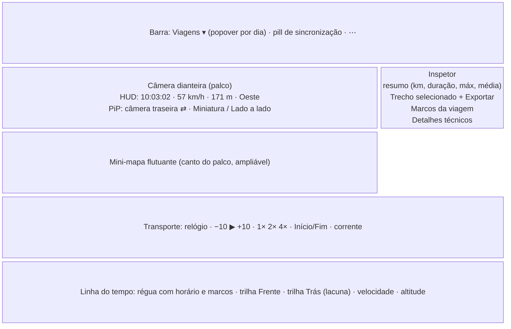
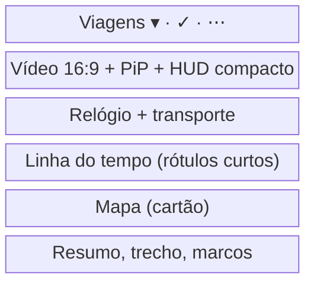
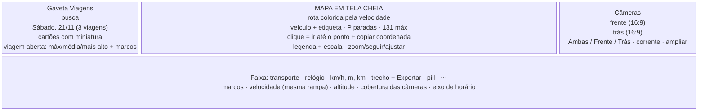
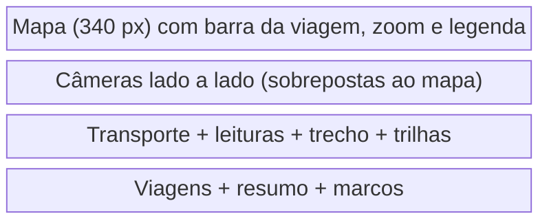
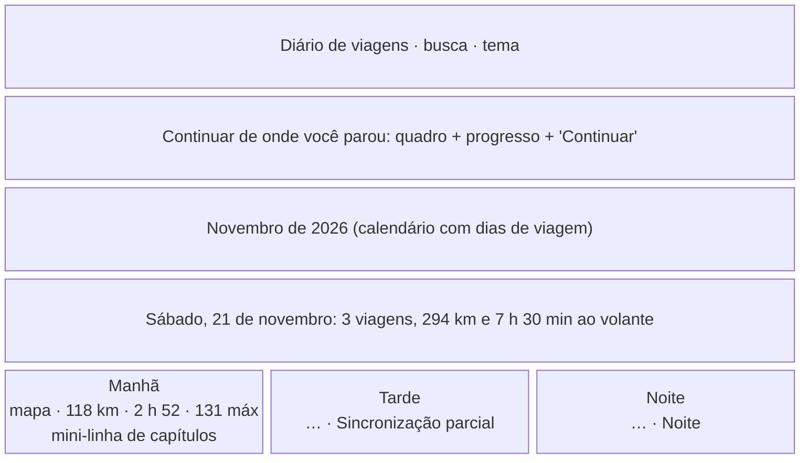
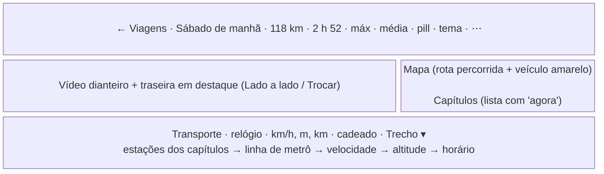

# Redesign do Estúdio de viagem — 3 opções

**Data:** 2026-11-22
**Base:** [`docs/superpowers/specs/2026-11-22-dashboard-use-cases-journey.md`](../../superpowers/specs/2026-11-22-dashboard-use-cases-journey.md) (UC1–UC11, J1–J4, P1–P11, critérios da seção 8)
**Protótipos:** `opcao-a.html`, `opcao-b.html`, `opcao-c.html` (nesta pasta). Abra com o servidor do projeto:
`./run.sh` e depois `http://localhost:8765/docs/ux/redesign-2026-11/opcao-a.html` (idem `-b`, `-c`; a tela de detalhe da C abre direto em `opcao-c.html#detalhe`).

> Os três protótipos usam os mesmos dados (`mock-data.js`) e o mesmo núcleo de comportamento (`proto-core.js`):
> relógio único, posição na rota, marcos derivados, atalhos e menus. A diferença entre eles é só de
> conceito, layout e identidade visual. Por isso a comparação é justa.
>
> **Dados locais:** `mock-data.js` e `frames/` são gerados localmente a partir de `data/trips.json` e dos vídeos
> e **não são versionados** (o repositório é público). Sem eles, os protótipos abrem sem dados.

---

## 1. Diagnóstico: o que está errado hoje e por quê

- **O conteúdo principal está escondido (P1).** Os vídeos começam por volta de y=1300 px. Num notebook não dá para ver vídeo e mapa ao mesmo tempo, que é justamente o propósito da página (J1: "ver mapa e vídeo ao mesmo tempo" tem nota 1).
- **Não existe um "agora" (P2).** O slider não mostra horário, os gráficos usam o índice do ponto no eixo X e o m:ss aparece só no mapa. O usuário pensa em horário real ("umas 10h", J2), e a página não mostra isso em lugar nenhum.
- **Há três controles de tempo que competem entre si (P3).** São dois players nativos e um slider, e a sincronização aparece como uma barra solta com jargão ("Independente / Sincronizado"). O modelo mental certo é um transporte só, que comanda tudo.
- **Informação de depuração aparece como conteúdo (P4, P8).** Caminho do `.mp4`, "Merged 153 rear + 153 front videos successfully", "8752 registros" e o badge vermelho "172 MIN" ocupam espaço nobre. Os avisos de qualidade, que importam, são frases laranja soltas, sem ícone nem explicação.
- **Hierarquia achatada (P5, P6).** Seis botões cinza do navegador têm o mesmo peso, embora exportar seja raro e assistir seja constante. O resumo da viagem parece uma planilha de duas colunas.
- **A linha do tempo não conta a viagem (P10).** Paradas, velocidade máxima e trechos sem vídeo não aparecem no tempo, e não dá para ajustar a seleção arrastando as pontas (atrito da J3).
- **Não escala e cansa a vista (P7, P9, P11).** A lista não tem agrupamento por dia, miniatura nem busca. O cabeçalho em gradiente roxo ocupa 120 px sem função. Não há atalhos nem modo escuro, e o vídeo noturno ofusca.

## 2. As três opções

| | A — Cinema | B — Mapa | C — Diário de viagens |
|---|---|---|---|
| Ideia | O vídeo manda, como num monitor de edição | O mapa manda, como num app de navegação | A viagem vira uma história, com biblioteca e capítulos |
| Protótipo | `opcao-a.html` | `opcao-b.html` | `opcao-c.html` (biblioteca) e `#detalhe` |

Comum às três (requisitos do briefing):

- **Um único transporte**: reproduzir/pausar, −10 s/+10 s e 1×/2×/4× comandam as duas câmeras, o marcador no mapa, o playhead dos gráficos e a linha do tempo. O **horário real** (10:03:02) aparece em destaque, com o tempo decorrido ao lado.
- **Atalhos**: espaço ou K (play/pausa), ← → (±10 s; Shift para ±1 min), J/L, I e O (início e fim do trecho), Esc (fecha menus). A opção A também usa M (ampliar mapa) e C (trocar câmera), e a B usa F (seguir) e +/−.
- **Sincronização das câmeras** deixa de ser uma barra e vira um ícone de corrente ou cadeado ao lado do player, com tooltip. No modo "independente", a traseira fica parada no momento escolhido, o que mantém o modelo do `video-sync.js` (`state.mode = linked|independent`).
- **Marcos derivados no front**: partida, subida e descida (maior ganho ou perda de altitude numa janela de 20% da viagem), paradas (`idle_segments`), velocidade máxima, trechos sem vídeo (`video_sync` nulo) e chegada. Uma lacuna de exemplo foi inventada na câmera traseira da viagem 1 e está marcada como "(exemplo)".
- **Seleção de trecho** com alças arrastáveis (mouse, toque e teclado), também desenhada no mapa. O export GPX/KML fica num menu secundário, com a nota "Exporta só o traçado do trecho…".
- **Qualidade dos dados**: um pill discreto ("Vídeo e GPS alinhados" ou "Sincronização parcial", visível na viagem 2) explica o problema em linguagem humana no tooltip. Caminhos, contagem de pontos e notas de importação ficam em **Detalhes técnicos**.
- **Clique no mapa** leva ao ponto mais próximo e oferece "Copiar coordenada" (UC8).
- Rótulo "Protótipo — dados de exemplo da viagem de 21/11" em todas as telas.

---

### Opção A — "Cinema" (player-first)

**Conceito:** a página vira um monitor de edição. A câmera dianteira ocupa o palco, a traseira fica em miniatura (PiP) e o mapa flutua num canto. Embaixo vem uma linha do tempo com trilhas, como num editor de vídeo.

**Para quem / jornada:** J2 ("o que aconteceu naquele momento?") e J4 ("posso confiar?"). Serve a quem revisa incidentes, volta segundos, compara frente e trás e precisa de precisão de editor.

**Identidade:** tema só escuro e deliberado, em grafite neutro de mesa de corte, com preto real apenas no monitor. O âmbar da luz de sódio marca o "agora" (playhead e seleção). Azul e verde identificam as trilhas Frente e Trás (paleta validada para daltonismo). Tipografia Barlow / Barlow Condensed, inspiradas em placas de rodovia, com números tabulares grandes no HUD. Raio de 5–6 px e sombra só nos elementos que flutuam sobre o vídeo.

No celular a ordem passa a ser vídeo → transporte → linha do tempo → mapa → resumo. O HUD cobre o carimbo gravado no quadro e assume o papel de fonte do horário.

| Critério (seção 8) | Como atende |
|---|---|
| 1. Tudo em 1440×900 | Vídeo de ~1035×582, mini-mapa, HUD, transporte e 5 trilhas, sem rolar |
| 2. Controle único + horário | Transporte central; o horário aparece no HUD e no transporte |
| 3. Marcos | Marcadores na régua, faixas hachuradas de parada, lacuna na trilha Trás, ponto da máxima |
| 4. Sem depuração | "Detalhes técnicos" recolhido no inspetor e no menu ⋯ |
| 5. Avisos humanos | Pill com tooltip; placa "Sem gravação traseira neste trecho" sobre o vídeo |
| 6. Visual contemporâneo | Tema escuro próprio, controles próprios, HUD |
| 7. Escala da lista | Popover agrupado por dia, com miniatura (limitado; ver riscos) |

| UC | Onde |
|---|---|
| UC1 / UC2 | Popover "Viagens" / inspetor |
| UC3 | Miniatura, Lado a lado, Trocar (ou clique no PiP) |
| UC4 / UC5 / UC11 | Mini-mapa com seguir e ampliar (M); clique no mapa, nas trilhas, nos marcos ou na lista |
| UC6 / UC7 | Trilhas de velocidade e altitude + HUD / faixas de parada e marcadores |
| UC8 / UC9 / UC10 | Chip de coordenada no mapa e menu ⋯ / painel "Trecho selecionado" / pill + Detalhes técnicos |

**Trade-offs e riscos:** é a opção mais densa e "técnica". Pode parecer uma ferramenta de edição para quem só quer ver por onde passou. O mapa pequeno é ruim para a J2 baseada em lugar ("na serra"), e só melhora ao ampliar. Ser só escura é uma escolha: de dia, num notebook, pode cansar. A lista de viagens num popover não escala bem para centenas.

**Esforço: M.** É uma tela só. A troca é de `<video controls>` por transporte próprio sobre o `video-sync.js` existente, Leaflet num contêiner flutuante e uma linha do tempo em SVG/HTML que substitui o Chart.js (ou mantém o Chart.js só nas trilhas). O tema único reduz o trabalho de CSS.

---

### Opção B — "Mapa / Mission control" (map-first)

**Conceito:** o mapa ocupa a tela inteira e é o chão da interface. Viagens, câmeras e telemetria são painéis flutuantes, como em Flightradar, Tesla ou Strava, e a rota é pintada pela velocidade.

**Para quem / jornada:** J2 baseada em lugar ("o que aconteceu na serra?") e exploração geral ("por onde andei e como dirigi"). É a mais "uau" ao abrir.

**Identidade:** tema claro de produto de mapas, com modo escuro completo. Quando a viagem é noturna e o tema está claro, um aviso sugere "Usar tema escuro". A rota usa uma rampa de um só matiz (laranja, de devagar a rápido) com legenda e escala em km. O azul segue a convenção "você está aqui" e o magenta a do trecho ativo em GPS aeronáutico. Tipografia Albert Sans. Raio de 14 px nos painéis flutuantes, sombra apenas no que flutua sobre o mapa, e etiqueta "10:03:02 · 57 km/h" presa ao veículo.

| Critério (seção 8) | Como atende |
|---|---|
| 1. Tudo em 1440×900 | Sim, mas com os vídeos menores (~376×211 cada) |
| 2. Controle único + horário | Faixa inferior com relógio e leituras do instante |
| 3. Marcos | Marcadores na faixa e no mapa, cobertura das câmeras, seleção magenta nos dois |
| 4. Sem depuração | Detalhes técnicos dentro do menu ⋯ |
| 5. Avisos humanos | Pill + tooltip; aviso de viagem noturna |
| 6. Visual contemporâneo | Linguagem de app de mapas, claro e escuro |
| 7. Escala da lista | Gaveta com busca e agrupamento por dia (média escala) |

| UC | Onde |
|---|---|
| UC1 / UC2 | Gaveta com busca / KPIs da viagem aberta |
| UC3 | Doca: Ambas, Frente, Trás, ampliar |
| UC4 / UC5 / UC11 | Mapa em tela cheia, seguir, etiqueta / clique no mapa, na faixa ou nos marcos / o mapa já é a tela cheia |
| UC6 / UC7 | Faixa com velocidade (mesma rampa do mapa) e altitude / "P 6m" no mapa + faixa hachurada |
| UC8 / UC9 / UC10 | Popover no ponto clicado / chip do trecho na faixa / pill + ⋯ |

**Trade-offs e riscos:** o vídeo, que é o conteúdo mais valioso (P1), fica secundário e pequeno. Para ler placas ou ver um incidente é preciso ampliar a doca. Painéis flutuantes sobre o mapa exigem cuidado com sobreposição em telas de 1280 px. Com tiles reais (CARTO Positron/Dark Matter), o estilo do mapa fica menos controlável que no protótipo.

**Esforço: M.** O Leaflet já faz quase tudo: polylines por faixa de velocidade, controles e `fitBounds` com padding para os painéis. O trabalho está no layout flutuante responsivo, no tema escuro (tiles + CSS) e na faixa de telemetria.

---

### Opção C — "Diário de viagens" (biblioteca + história)

**Conceito:** a página abre numa biblioteca de viagens agrupadas por dia, com mapa em miniatura e "continuar de onde parou". O detalhe conta a viagem em capítulos automáticos: Partida, Subida de 730 m, Parada de 6 min, Velocidade máxima 131 km/h, Chegada.

**Para quem / jornada:** J1 ("revisar a viagem de hoje", a mais frequente) e qualquer pessoa não técnica. É a única opção que trata o crescimento para centenas de viagens (critério 7) como parte do produto.

**Identidade:** claro por padrão, com escuro completo. Ardósia sobre cinza frio. O **amarelo da faixa de estrada** marca o "agora" (botão de play, playhead, veículo, capítulo atual) e o azul de placa de serviço marca a seleção. Tipografia Familjen Grotesk em títulos e números, com Atkinson Hyperlegible no texto corrido (fonte desenhada para legibilidade). Raios generosos (16 px) e linha do tempo como uma **linha de metrô**, com estações nos capítulos e trechos coloridos nas subidas, paradas e lacunas.

No celular a biblioteca vira uma coluna. No detalhe a ordem é título → vídeo → transporte e linha → mapa → capítulos, e os rótulos das estações viram só ícones.

| Critério (seção 8) | Como atende |
|---|---|
| 1. Tudo em 1440×900 (detalhe) | Vídeo de ~1014×570, mapa, capítulos, transporte e linha, sem rolar |
| 2. Controle único + horário | Barra da história com relógio e leituras |
| 3. Marcos | Estações + trechos coloridos + lista de capítulos sincronizada |
| 4. Sem depuração | Detalhes técnicos no menu ⋯ |
| 5. Avisos humanos | Pill + tooltip; badge "Sincronização parcial" já no cartão da biblioteca |
| 6. Visual contemporâneo | Claro e escuro, tipografia legível |
| 7. Escala da lista | Biblioteca por dia, calendário do mês, busca, cartões com mapa e resumo |

| UC | Onde |
|---|---|
| UC1 / UC2 | Biblioteca e "continuar" / cartão + cabeçalho do detalhe |
| UC3 | Traseira em destaque (toque para trocar), Lado a lado |
| UC4 / UC5 | Cartão de mapa com seguir / mapa, estações, linha, lista de capítulos |
| UC6 / UC7 | Faixas de velocidade e altitude separadas / estação + trecho azul + "P" no mapa |
| UC8 / UC9 / UC10 | Barra de coordenada no mapa + ⋯ / popover "Trecho" / pill + ⋯ |
| UC11 | **Não prototipado.** Proposta: botão que troca mapa e vídeo de lugar |

**Trade-offs e riscos:** são duas telas e mais conceito para manter (capítulos derivados, calendário, busca). Com 3 viagens a biblioteca parece vazia, e o valor só aparece com volume. Os capítulos dependem de heurísticas (janela de altitude, limiar de parada) que precisam de ajuste com dados reais. O mapa do detalhe é menor que na B.

**Esforço: G.** O detalhe custa o mesmo que a A (M). Somam-se a biblioteca (agrupamento, miniaturas de rota simplificadas, busca, calendário), a navegação por hash, a derivação dos capítulos e os dois temas. Pode ser entregue em duas fases (ver recomendação).

---

## 3. Comparativo

| | A — Cinema | B — Mapa | C — Diário |
|---|---|---|---|
| Protagonista | Vídeo | Mapa | A viagem (história) |
| Vídeo em 1440×900 | ~1035×582 + PiP | 2 × ~376×211 | ~1014×570 + destaque |
| Mapa | Mini-mapa ampliável | Tela cheia, colorido pela velocidade | Cartão médio |
| Linha do tempo | Trilhas de editor (mais precisa) | Faixa compacta | Linha de metrô com capítulos (mais legível) |
| Lista de viagens | Popover por dia | Gaveta com busca | Biblioteca + calendário + continuar |
| Tema | Só escuro | Claro + escuro (sugere escuro à noite) | Claro + escuro |
| Melhor jornada | J2 por momento, J4 | J2 por lugar, exploração | J1, uso casual, escala |
| Curva de aprendizado | Média (vocabulário de editor) | Baixa | Muito baixa |
| Ataca P1 / P7 | Forte / fraco | Médio / médio | Forte / forte |
| Esforço | M | M | G (M + biblioteca) |
| Risco principal | Parecer ferramenta técnica | Vídeo pequeno demais | Heurísticas de capítulo; biblioteca vazia no início |

## 4. Recomendação

**Recomendo a C, "Diário de viagens", como direção, entregue em duas fases.** O dono pediu algo "moderno, amigável e com cara de produto", e a C é a única que responde às três coisas ao mesmo tempo. Ela resolve o problema crítico (vídeo e mapa juntos na dobra, P1/P2) com a mesma força da A, mas conta a viagem em vez de mostrar dados. Também é a única que se prepara para o volume que vem (dezenas a centenas de viagens, P7).

- **Fase 1 (M): só a tela de detalhe da C**, substituindo a página atual. É aqui que está o ganho da J1 e da J2.
- **Fase 2 (P/M): a biblioteca**, quando houver mais de uma dúzia de viagens. Até lá, o seletor do cabeçalho resolve.

**O que trazer das outras duas:**

- **Da A:** o HUD com horário real sobre o vídeo (opcional, ligado no modo escuro), as trilhas Frente/Trás com lacunas como camada de detalhe da linha de metrô ("mostrar trilhas"), as teclas I/O e M e o "ampliar mapa" que troca de lugar com o vídeo (fecha o UC11).
- **Da B:** a rota colorida pela velocidade como alternativa no mapa ("colorir por velocidade"), com a mesma rampa no gráfico de velocidade; a etiqueta "horário · km/h" presa ao veículo; a escala em km; e o aviso "Viagem noturna: usar tema escuro?".

**Notas para a implementação (fora deste mockup):** manter o `video-sync.js` intacto. O transporte único chama `play/pause/currentTime` na câmera ativa e o módulo propaga para a outra. O horário real sai de `start_timestamp + time_offset_s`. Os IDs vão mudar, então os testes de `tests/test_frontend_accessibility.py` precisam ser atualizados no mesmo PR (TDD, conforme o CLAUDE.md).

## 5. Limitações conhecidas dos protótipos

- **Reprodução acelerada 60×** para que o marcador ande de forma visível. Na página real, 1× é tempo real e o relógio vem do `<video>`.
- **Quadros ilustrativos:** 7 JPGs alternam por trecho com crossfade. O carimbo gravado no quadro (por exemplo, 09:48:12) não corresponde ao horário do playhead.
- **Mapa gerado:** costa, ruas, parques e relevo são desenhados a partir da rota normalizada, sem geografia real e sem tiles (restrição de CSP). As coordenadas copiadas são ilustrativas.
- **Lacuna da câmera traseira** na viagem 1 (10:52–10:57) é inventada e está marcada como exemplo.
- **Exportar** mostra só a confirmação (nome do arquivo). Nenhum arquivo é gerado.
- A busca, o tema escolhido e o "continuar de onde parou" são locais ao protótipo.
